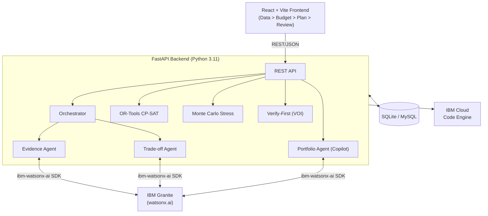

# VidyaPlan

**Budget-Constrained Infrastructure Planner for Karnataka Schools**

> An uncertainty-aware, agentic AI planner — Inter-Institute IBM Bob Hackathon, Problem Statement 17.

[](https://github.com/your-org/vidyaplan/actions)

---

## One-Paragraph Pitch

VidyaPlan funds what the records prove, and tells planners exactly what to verify next.
Most tools find gaps and run a knapsack. VidyaPlan does that — and adds two things that
real government planners need: knowing *how fragile* a plan is because of missing data
(Monte Carlo stress-test), and knowing *which field visit* would improve the plan most
(Value of Information ranking). Built with IBM Granite for grounded explanations, OR-Tools
CP-SAT for deterministic optimisation, and a pastel React dashboard for a polished,
accessible user experience.

---

## Live URL

> _Deploy to IBM Cloud Code Engine and paste URL here._

---

## Architecture



---

## Requirement Traceability

| Problem-statement requirement | How VidyaPlan meets it |
|---|---|
| Transparent planning, documented needs only | Only CONFIRMED_GAP records are funded; every pick has a reason code and a plain-language explanation |
| Account for missing data | MISSING/UNRELIABLE are tagged, excluded, stress-tested; never silently imputed |
| Configurable costs and weights | `config/costs.yaml` + `config/weights.yaml`, editable from Settings drawer |
| Electricity dependency for computers | CP-SAT constraint + BLOCKED_PREREQ_UNVERIFIED state |
| MVP: 30–50 schools, 3 interventions | Cohort of 40 (default), electricity / library / computers |
| Budget-constrained optimisation | OR-Tools CP-SAT integer program, deterministic, seed-fixed |
| Three agents | Evidence, Portfolio Planning, Trade-off Explanation |
| Interactive dashboard | 4-step React flow: Data / Budget / Plan / Review |
| Compare scenarios | B / -30% / +30% + marginal view |
| SIMULATED vs OFFICIAL clearly distinguished | ProvenanceBadge on every figure |
| Human review before final decisions | Approve/reject gate + append-only audit_log |
| IBM Bob + Granite + IBM Cloud | Used throughout — see IBM Technology section |

---

## IBM Technology Usage

| Technology | Concrete use |
|---|---|
| **IBM Bob** | Built the entire application iteratively using the VidyaPlan playbook prompts |
| **IBM Granite** | Generates 1-2 sentence plain-language notes per school and per recommendation; a grounding check rejects any output containing invented numbers; deterministic template fallback when unavailable |
| **IBM Cloud (Code Engine)** | Hosts the production container with min-scale=1 (no cold start during demo) |
| **watsonx.ai** | Model inference endpoint for Granite; project + API key configured via environment variables |

---

## Quick Start

```bash
# Clone and set up
cp .env.example .env
# Edit .env with your watsonx credentials

# Backend
cd backend
pip install -r requirements.txt
python -m app.pipeline.load   # loads CSV from data/raw/
uvicorn app.main:app --reload --port 8000

# Frontend
cd frontend
npm install
npm run dev    # → http://localhost:5173
```

---

## Configuration

All costs, weights, and evidence rules are stored in `config/*.yaml` and can be edited without code changes.

| File | Purpose |
|---|---|
| `config/costs.yaml` | Intervention costs in Rs. (all SIMULATED) |
| `config/weights.yaml` | Priority weights (all SIMULATED) |
| `config/columns.yaml` | CSV column → canonical field mapping |
| `config/rules.yaml` | Evidence classification rules per facility |

---

## API Overview

| Method | Path | Purpose |
|---|---|---|
| GET | `/health` | Liveness, DB status, watsonx configured |
| GET | `/api/data/summary` | Evidence state counts, cohort info |
| GET | `/api/schools` | Filterable school list with evidence chips |
| POST | `/api/plan` | Run CP-SAT optimiser |
| POST | `/api/plan/stress` | Monte Carlo stress-test |
| GET | `/api/plan/{id}/verify-first` | VOI-ranked Verify-First Queue |
| POST | `/api/plan/compare` | B / -30% / +30% scenario comparison |
| GET | `/api/plan/{id}/baselines` | Optimiser vs greedy vs random |
| POST | `/api/copilot` | Natural-language → validated tool call → result |
| GET | `/api/plan/{id}/explanations` | Trade-off agent rationales |
| POST | `/api/reviews/{id}` | Approve or reject a recommendation |
| GET | `/api/plan/{id}/memo.pdf` | Decision memo PDF export |
| GET | `/api/audit` | Append-only audit timeline |

Full interactive docs at `/docs` (Swagger UI).

---

## Testing

```bash
cd backend
python -m pytest tests/ -v         # 30+ unit tests
python scripts/smoke_test.py       # 12 API endpoint tests
```

---

## Limitations and Responsible AI Notes

- **2017-18 data** — may not reflect current school status. Verify before acting.
- **Simulated costs and weights** — not official government estimates. Labelled SIMULATED throughout.
- **VOI is a heuristic** — single-field, ignores correlations between missing records.
- **Human review required** — plan is not FINAL until all selected recommendations are approved.
- **Granite explanations** — grounded and validated, but not a substitute for domain expertise.
- **No school names in dataset** — schools identified by SCHCD code only.

---

## Repo Layout

```
vidyaplan/
├── backend/app/        FastAPI app, solver, agents, pipeline, export
├── frontend/src/       React + Vite + TypeScript, pastel design system
├── config/             costs.yaml, weights.yaml, columns.yaml, rules.yaml
├── data/raw/           Original CSV (never edited)
├── docs/               Architecture, demo script, deploy guide, PPT outline
├── scripts/            smoke_test.py, startup.sh
└── .github/workflows/  CI pipeline
```

---

## License

MIT
