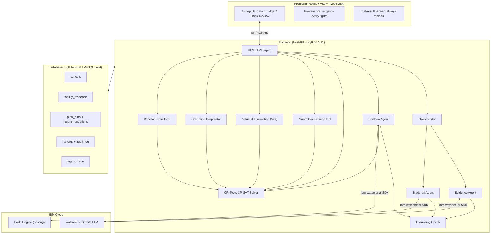

# VidyaPlan — Architecture

## Overview

VidyaPlan is a budget-constrained infrastructure planner for Karnataka schools.
It is built with a React frontend, a FastAPI backend, and an OR-Tools CP-SAT solver.
IBM Granite LLM provides grounded natural-language explanations.

## Architecture Diagram

## Component Responsibilities

| Component | Responsibility |
|---|---|
| `evidence/classifier.py` | Deterministic CONFIRMED_GAP/OK/MISSING/UNRELIABLE classification |
| `solver/model.py` | OR-Tools CP-SAT integer program with dependency constraint |
| `solver/stress.py` | Monte Carlo robustness + expected regret |
| `solver/voi.py` | Value of Information — Verify-First Queue |
| `solver/scenarios.py` | B / -30% / +30% scenario comparison + marginal view |
| `solver/baselines.py` | Optimiser vs greedy vs random baselines |
| `agents/granite_client.py` | watsonx.ai SDK wrapper — cache, retry, template fallback |
| `agents/grounding.py` | Rejects LLM output containing invented numbers |
| `agents/evidence_agent.py` | Per-school notes + district summaries via Granite |
| `agents/tradeoff_agent.py` | Per-item funded/deferred rationales via Granite |
| `agents/portfolio_agent.py` | NL → JSON tool call → solver (Scenario Copilot) |
| `agents/orchestrator.py` | Chains agents, records agent_trace |
| `export/memo_pdf.py` | Decision memo PDF via reportlab |
| `api/routes_review.py` | Human review gate + append-only audit_log |

## Non-Negotiable Design Rules

1. **LLM never computes or invents numbers** — all figures come from DB or solver; Granite only phrases them.
2. **Provenance on every figure** — OFFICIAL (2017-18 dataset) or SIMULATED (costs, weights, Monte Carlo).
3. **No silent imputation** — MISSING and UNRELIABLE data are tagged, excluded, logged.
4. **Dependency constraint** — computers require electricity (funded in same plan or already present).
5. **Template fallback** — every watsonx call has timeout, retry, cache and a deterministic fallback.
6. **Human in the loop** — plan is not FINAL until all selected recommendations are reviewed.
7. **Config, not constants** — costs, weights, rules, column mapping in `config/*.yaml`.
